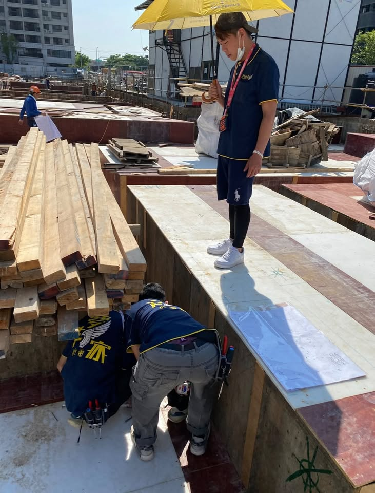

### 專案概要
我的第一篇blog文章 自我介紹 

## 我的人生歷程
大家好，終於輪到我來撰寫自我介紹，分享我的人生歷程了。雖然我才 19 歲，但這幾年的經歷也算滿精彩的。從小到國中畢業前，我都在爸媽的保護下長大，沒什麼特別好說的，所以就從國中畢業那年開始講起吧！

國中畢業時大概是 2022 年，當時我才 14 歲，因為不想整天待在家，很想出去打工。但政府規定至少要滿 16 歲才能合法打工，於是我只好騎著腳踏車，到處詢問家附近的路邊攤，甚至騎到離家一公里以外的店家碰運氣。飲料店、小吃店、吃到飽餐廳、萬X福我都問過，到最後實在找不到，我甚至跑去問檳榔攤有沒有缺人。結果檳榔攤阿姨看了我一眼，回我：「我找男的幹嘛？」當時我還搞不懂這是什麼意思，心裡甚至想說：「難道政府有規定男生不能賣檳榔嗎？」現在回想起來，當時的我還真傻，也忍不住想到那些店家看我的眼神，真不知道以前的自己到底哪來的勇氣。

回歸正題，各大店家都不收我，大概是看我年紀太小、連 16 歲都不到，覺得我是來亂的吧。後來某天，我和另外兩個朋友騎著腳踏車到處亂晃，好巧不巧騎到了一處正在施工的工地。我前面就說過，我真的不知道以前哪來的勇氣——沒錯，我們就這樣走進去了。

一開始我先問警衛：「請問這邊有缺人嗎？」警衛上下打量了我們大概十秒，打開門說：「自己進去問問看。」走進去後，映入眼簾的畫面成了我這輩子忘不了的震撼。或許是當時個頭還小、沒見過世面，覺得特別可怕：裡面有一群皮膚曬得黝黑的大哥，身上刺龍刺鳳、嘴裡叼著菸，正聚在一起打牌賭博，桌上還擺著保力達配台灣啤酒。我必須再說一次，我真的不知道當時哪來的膽子，竟然還是硬著頭皮上前問：「請問這邊還有缺人嗎？」

大概有五位大哥看著我們發呆，過了五秒、十秒，一位坐在 C 位的大哥（姑且稱他為 A 老闆）可能喝了點酒，大聲吆喝旁邊三位去上工，桌邊只剩下他和另一位 B 老闆。A 老闆開口說：「想要找工作，還不帶點伴手禮來喔？」我當下傻傻地掏出 500 元零用錢跑到福利社，還特地問老闆裡面的工人都喜歡喝什麼，最後拎了幾罐台灣啤酒回去找 A 老闆。

接著不知道為什麼，A 老闆開始跟 B 老闆用一堆我聽不懂的資深台語聊了起來。我們就這樣罰站似的待在旁邊，路過的工人不時投來打量的眼光，當下其實很害怕，完全不懂自己怎麼會誤打誤撞跑進工地。兩位老闆聊了快十分鐘，中途雖然一直叫我們放鬆、別那麼拘束，但他們討論的架勢簡直像要把我們賣掉一樣，哪有可能不緊張！後來 B 老闆先離開了，A 老闆轉頭問我們三個：「一天給你們 800 元，要不要做？」我記得 2022 年的最低時薪好像是 168 元，心裡飛快算了一下，168 乘以 8 小時隨便也超過 1,000 元。但當時想說工作這麼難找，我們還是答應了。

在這裡稍微說明一下，工地裡分很多工種，像是板模、水電、綁鐵，還有最底層的粗工。沒錯，我們被分配到的就是最底層、專做最髒最累活的粗工。A 老闆帶我們走進工地後，14 歲的我看到了許多充滿衝擊感的畫面：有人直接對著牆壁尿尿、有人邊喝酒邊敲鐵釘，也有身心障礙者一步步扛著 20 公斤的物料上樓。走到高樓層時，因為沒有廁所也沒有電梯，上下樓太浪費時間，甚至有人會在小隔間地上鋪塑膠袋直接蹲著上大號，上完把袋子包一包就從高處往下丟——沒砸到人、袋子沒爆開就謝天謝地了。雖然現在聽起來見怪不怪，但當時的我就像隻剛學會野外求生的小猴子，看到這場面真的有點想回家。接著我們來到指定崗位，A 老闆要我們把四樓的鐵柱搬到五樓。我們三個分工合作：一個在樓下搬、一個站鷹架上中繼、一個在樓上接應，搬完休息一下再換下一間，這就是粗工的日常。

做沒多久，A 老闆突然叫我們停手，下去樓下等 B 老闆。原來是 B 老闆想收留我們這三個未滿 16 歲的年輕人。我們坐上他的車，被載到高雄的大昌醫院，那裡剛好在做管線工程。B 老闆在車上說：「我一天給你們 1,200 元好嗎？以後就跟著我就好了。」我們馬上在手機群組裡歡呼，終於拿到比較像樣的薪水了！

然而，這也成了我人生中最硬的「鐵人訓練」。到目前為止，我打過這麼多工，敢保證沒有任何工作比水電還累。一開始老闆沒讓我們直接學配管，一到現場就指著一片工地空地，叫我們三個去那裡曬太陽。我們心想「曬曬太陽就有錢拿，誰不要？」於是爽快答應了。但別忘了，那時剛畢業正是六月天，太陽毒得要命，這幾個月下來直接把我曬得一身黑。

曬了幾天太陽後，到了第五天，我們三個菜鳥終於領到老闆發的牛仔工作褲和基本工具，開始在師傅的梯子下遞工具，或是等師傅在天花板量好管線尺寸後，由我們在下面用砂輪機裁切。那台砂輪機大概有我三分之一的體型那麼大，運轉起來吵到不行，現場也沒什麼防護措施。而且多了我們三個菜鳥，只要搬料（水管）一定是我們保底扛起來。說真的，4 吋厚的塑膠管一人扛一支還算好應付，最崩潰的是要把一堆 2 吋厚管一起扛在肩上——管子太多支、每支重心不同還會分叉，重量感覺快比我體重還重。我當時真的搬到眼眶泛淚，不是因為覺得委屈想哭，而是肩膀壓到神經痛到自動流淚，就像打球不小心被打到眼睛，明明不想哭，眼淚卻止不住一樣。

那段時間，我每天都在曬太陽、搬水管、幫師傅拿料。每天下午五點前，大家會討論今天要不要加班，大概每五天會加個三天，時間也不固定，有時甚至會從早上八點一路做到晚上十一點。我知道這早就違反勞基法了，但當時似乎沒抓很嚴（甚至現在可能也是）。加班到十一點再去吃個宵夜，回到家都十二點了，隔天早上八點又得準時上工，現在回想起來也算是非常「充實」。

開學後，因為一些原因我沒繼續做水電，轉而回去做粗工。雖然粗工領的薪水低、活又辛苦，但勝在時間彈性，隨時想去就去、不想去也能休。每個禮拜五我都會跟朋友討論這週末要不要去打工。要說很累嗎？其實比水電輕鬆多了；壓力很大嗎？上班還能跟朋友聊天，而且工地裡的師傅雖然刺龍刺鳳，卻常跟我們開玩笑，對我們特別照顧，算是一種很可愛的反差。那陣子我跑遍了高雄大大小小的工地，85 大樓旁邊的建案、仁武區、楠梓區，還有美術館的超高層大樓都去過，休息時就四處觀察其他工種的師傅施工，覺得特別有趣。

不過，工地待久了，我也見識到這個環境比較黑暗的一面。在裡面認識了來自各行各業的人，有以前當酒店經紀、常跟我們分享載小姐上班故事的大哥，有金盆洗手、努力賺錢的前黑道，我甚至還親眼看過有人在工地運送毒品，那是我第一次見到真正的毒品包裝。

到了滿 16 歲後，我正式離開了工地，轉而嘗試各種不同的打工，像是家樂福、摩斯漢堡、全家便利商店、吃到飽餐廳，甚至也進過科技廠當產線作業員。或許就是因為把太多時間花在打工上，沒什麼時間念書，才讓我沒考上公立學校。不過這也不能全怪打工，畢竟這都是我自己做的選擇。

而且在這些打工經歷中，我學到的東西多到數不清。舉例來說，在摩斯漢堡，我學到了整間店的運作邏輯與留住客人的細節，像是擺盤技巧、服務小動作，甚至發現只要在客人開口前主動推薦餐點，那份餐點的售出率就能提高約 30%；我也明白「就算後場忙成一團，只要呈現在客人眼前的狀態是完美的，那就萬事 OK」。這些歷練讓原本做事就還算穩重的我，更學會了如何在突發狀況下冷靜處理問題。

就這樣一路跌跌撞撞地上了大學，雖然目前還談不上有什麼大成就，但我期許自己有一天能真正出人頭地。

## 迷茫的大一生
大一上學期，我經歷了一段漫長的迷惘期。當初未能錄取理想志願，面對勤益工管的面試機會，我清楚自己志在電機，幾經取捨後，選擇了離家就近的正修電機就讀。

入學之初，我抱持著「既來之，則安之」的態度，期許自己能在這裡踏實學習。然而，現實環境的落差很快顯現。原先近五十人的班級，隨著學期推進，休學與缺課者漸增，最後實到人數往往僅剩二十餘人。比起人數的遞減，更讓我感到消磨的是消極的學習氛圍——多數人上課滑手機、補眠，彼此間少有深度交流，下課便各自離去；加上大一基礎課程有近九成早已在高中階段熟習，日復一日缺乏刺激與突破的日常，讓我感到自己如機械般空轉。

為了尋求突破，我著手規劃轉學。然而，當時的我在專業作品集與專題歷程上的準備經驗極為有限，即便維持了亮眼的學業成績，最終仍因缺乏具體成果而未能如願。

那次轉學失利雖然是一記挫折，卻也成為關鍵的轉折點。我意識到怨懟環境並無助益，既然我還年輕，就更有試錯與扎根的資本。我收起焦慮，將全副心力轉移到專題研究與實作技術的鑽研上。從那一刻起，我不再被動等待環境帶動我，而是主動為自己的專業找出路，一步步走到了現在的大二。

## 我的夢想